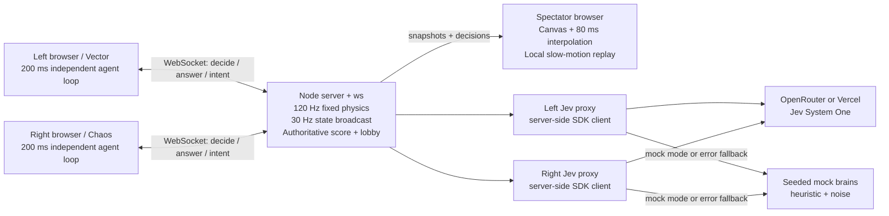

# Jev vs Jev Pong

A recording-ready AI rivalry for Ruben Casas ([@Infoxicador](https://x.com/Infoxicador)). VECTOR plays the angles. CHAOS brings the attitude. Two independent browser agents, one authoritative arena, no human paddle controls.

## Run

Requires **Node.js 22+** and npm. Tested with Node **24.14.0**.

```sh
cd jev-pong
npm ci
npm run demo
```

The launcher starts the Vite + Node server on **http://127.0.0.1:5177**, installs Chromium on first use if necessary, and opens three independent Chromium app windows side by side: **Vector | Spectator | Chaos**. Close a window or press Ctrl+C in the terminal to close the demo and its server. Window positioning uses Chromium's desktop API; a desktop window manager can override it.

For manual windows, run `npm run dev`, then open:

- Player Left: http://127.0.0.1:5177/?side=left
- Player Right: http://127.0.0.1:5177/?side=right
- Spectator: http://127.0.0.1:5177/?spectate

Use one hostname consistently. A player view owns one paddle. Opening an occupied seat becomes a spectator; it never steals the existing player's loop. Both player windows must stay open. Leaving pauses the game in the lobby; reconnecting preserves score and starts a fresh serve. A dropped WebSocket reconnects automatically with backoff. Chromium app windows keep both agent loops active while the spectator is being recorded.

Choose a different port with `PORT=5178 npm run demo`. The launcher refuses an occupied port. Dev HMR uses the game port plus 1000. Production: `npm run build && npm start` serves the built client from the same Node server.

## Jev versus Luna mode

The original **Jev vs Jev** matchup remains the default. Choose **Jev vs Luna** in the arena to run Jev on the left and **GPT-6 Luna through OpenAI Decisions** on the right. Mode changes start a fresh match and are broadcast to every connected window; refreshing a player keeps the server-selected matchup.

To open the three windows with Luna already selected:

```sh
npm run demo:luna
```

Or set `PONG_MATCHUP=jev-vs-luna` when starting `npm run dev` or `npm start`. Add this server-side credential to the ignored `.env.local` file to enable real Luna decisions:

```dotenv
OPENAI_API_KEY=your-openai-api-key
# Optional: fail startup/mode activation if the OpenAI key is missing.
LUNA_MOCK=0
```

Configure a real Jev provider as described below to run both sides live. Each side independently defaults to a mock if its own key is absent; the header shows **LIVE + MOCK** for a mixed configuration. `LUNA_MOCK=1` mocks only Luna. `JEV_MOCK=1` forces both players to use mocks, even if keys are configured. Each decision card identifies the actual model and whether its action was live, mocked, or a fallback. A mock Luna match exercises the wiring and presentation; it does not evaluate Luna's ability.

`server/luna.ts` uses Web-standard `fetch` to call **`POST https://api.openai.com/v1/decisions`** with the model pinned to **`gpt-6-luna`**. This uses the Decisions endpoint, not Responses or chat completions. It sends a user message with text rules and an `input_json` game snapshot. Three typed `choice` questions ask for the same 17 target lanes, movement directions, and persona taunts used by Jev. Both sides receive the same geometric intercept hint and have the same 200 ms scheduling and paddle-speed limits. The action controller still follows `target_y`; `move` is informational.

OpenAI returns a named `answers` array. The adapter validates each expected choice, refuses unknown lanes/models, and treats refusals, missing/duplicate answers, invalid confidence, HTTP errors, or a 1500 ms timeout as a **Luna-labeled heuristic fallback**. There are no automatic retries. Keys and provider HTTP requests stay on the server. The browser receives safe player metadata and actions only.

Source checked for this implementation: [official OpenAI Decisions guide](https://developers.openai.com/api/docs/guides/decisions) and [create-decision API reference](https://developers.openai.com/api/reference/resources/decisions/methods/create). `npm run test:luna` exercises the real HTTP adapter against local contract fixtures; no paid OpenAI call is needed. `npm run verify` now includes this test and a second three-context Playwright scenario that scores a Jev-vs-Luna point in mock mode, checks model labels across views, switches back to Jev-vs-Jev, and tests reset/reconnect/layout.

## Recording for X

Record the spectator window at 1440×1080 or 1920×1080; maximize that window after the three seats connect. The layout also fits a 1280×800 laptop and narrow player windows. Click **Title card**, start recording, then **Start fresh match**. The title card resets the score as it closes. Alternatively use `/?spectate&intro`.

The arena includes luminous ball trails, target markers, a live rally counter, best rally, match point at six, a winner at seven, and automatic rematches. Each agent shows its latest structured decision, confidence, measured round-trip decision time, and a persona-specific taunt. Everything important is visible with the audio muted. **Replay last point** plays the previous point's final eight seconds at 0.65× speed, locally; **Back to live** returns immediately. Live agents keep playing during replay. **New match** resets score and history.

Fonts ship locally. There are no external image or font requests and no account or internet needed after installation in mock mode.

## Add a real Jev key

```sh
cp .env.local.example .env.local
```

Edit `.env.local` with **one** provider:

```dotenv
JEV_PROVIDER=openrouter
OPENROUTER_API_KEY=your-openrouter-key
JEV_MODEL=jev-1.13
JEV_MOCK=0
```

Or:

```dotenv
JEV_PROVIDER=vercel
AI_GATEWAY_API_KEY=your-gateway-key
JEV_MODEL=typesafe-ai/jev
JEV_MOCK=0
```

Restart the server after editing. `JEV_MOCK=1` always forces mock mode. Without any key, mock mode is automatic. `JEV_MOCK=0` fails startup if a real key is missing. If both keys exist, OpenRouter wins unless `JEV_PROVIDER` chooses otherwise. Provider model IDs can be changed with `JEV_MODEL`.

Keys load only in Node from the ignored `.env.local` file; never use a `VITE_` prefix. The browser never imports the SDK, receives credentials, or calls a provider. Each joined player triggers its own server-side `TypeSafeClient` proxy. Requests use the server's current state, not a client-supplied snapshot. Requests stop in the lobby and at match end; there is at most one in flight per player. Real mode makes paid provider calls, up to five calls per second per player when responses are fast enough.

## The real SDK API

This uses **`@typesafe-ai/sdk` 0.7.0**, checked against its installed npm README and TypeScript declarations. Jev is a System One decision model: it selects from typed alternatives, rather than writing arbitrary JSON or free-form trash talk.

`server/jev.ts` calls `TypeSafeClient.systemOne({ model, state, questions })` with three `choice()` questions. The response's `answers.<name>.choice` selects:

- `target`: one of 17 paddle-center lanes, converted to a numeric `target_y`.
- `move`: `up`, `down`, or `stay`, shown as the model's movement classification.
- `taunt`: one of four short lines belonging to that persona.

The smooth controller follows `target_y`; the `move` field is informational. The compact snapshot contains ball position/velocity, both paddles, side, score, rally, and tick. A local geometric intercept is included as evidence in real-mode state; **Jev chooses the lane**, and may disagree with it. This is an assisted decision demo, not a claim of learned Pong skill or a model benchmark.

Provider routing follows the documented System One-compatible APIs:

| Provider | SDK `baseURL` | Default model |
| --- | --- | --- |
| OpenRouter | `https://openrouter.ai/api` | `jev-1.13` |
| Vercel AI Gateway | `https://ai-gateway.vercel.sh/typesafe` | `typesafe-ai/jev` |

The SDK appends `/v1/systemone`. Compression is disabled for gateway compatibility. Calls have a 1500 ms timeout and no retries; a provider error, invalid answer, or timeout uses the heuristic for that decision and visibly labels **FALLBACK / HEURISTIC**. The header identifies the configured provider; each decision card identifies the actual decision source. Taunts are throttled for reading, so a bubble can lag the latest action.

Sources: [official SDK repository/README](https://github.com/typesafe-ai/typesafe-sdk-js), [OpenRouter's TypeSafe SDK guide](https://openrouter.ai/docs/guides/community/typesafe-sdk), [Vercel's Jev integration guide](https://vercel.com/i/jev-integrations). Live provider billing, model availability, and performance require a valid key and are not established by the offline tests.

## Architecture



Physics has no clock, randomness, I/O, or AI calls: `step(state)` always advances exactly 1/120 second. A monotonic accumulator runs it on the server, caps catch-up after long stalls, and pauses the match when a seat is empty. Intents are validated against the latest server-issued decision sequence, consumed once, clamped to the court, and followed with proportional smoothing and a maximum paddle speed. Stale intents recover toward center. Clients only render buffered authoritative snapshots; they never integrate ball physics or decide scores.

The server stores up to eight seconds of 30 Hz frames for highlights. This local demo has one in-memory match, binds to loopback, checks WebSocket Origin, and limits message size/rate. Reloading the server clears match history. No database, deployment, or publication is involved.

## What's mocked

With no key (or `JEV_MOCK=1`), **both AI calls** are replaced by an explicitly labeled seeded heuristic brain. It projects wall bounces, recovers to center, and adds persona-specific noise that grows during rallies. Simulated decision latency is 45–91 ms. Confidence is synthetic. Taunts are selected from the same finite catalog used for real Jev questions.

**Nothing else is mocked:** browser contexts, HTTP, WebSockets, physics, paddle smoothing, scoring, join/leave/reconnect, and replay are real. Real-provider adapter verification runs the actual SDK against a local HTTP fixture that follows its documented response contract. It does not prove a live provider accepts an account's key or serves a particular model.

## Verification

```sh
npx playwright install chromium
npm run build          # strict TypeScript check + Vite production build
npm test               # Vitest in real headless Chromium
npm run test:provider  # actual Jev SDK over local HTTP: success, 429, malformed, timeout
npm run test:luna      # OpenAI Decisions HTTP contract, refusal/errors/timeout, per-side config
npm run test:e2e       # production server + three separate browser contexts
PORT=5178 JEV_MOCK=1 npm run demo:smoke
```

`npm run verify` runs build, unit tests, both provider adapter tests, and e2e in sequence. The e2e starts and stops its own server on 5187 with `JEV_MOCK=1`, opens left/right/spectator in separate contexts, observes actual WebSocket frames and sent agent intents, checks ball/paddle movement, waits for a point, exercises replay, disconnects and reconnects a player, preserves score, reloads a seat, opens the title card, resets the match, and checks a 480px layout for horizontal overflow. Screenshots are saved under ignored `test-results/`. `demo:smoke` launches the real launcher in headless mode and checks both player connections and visible mock decisions.

Unit coverage: deterministic stepping, lobby/serve, wall and paddle collisions, rally acceleration, scoring once, win condition, target bounds, reflected intercept prediction, reproducible noise, valid actions, persona taunts. See `VERIFICATION.md` for recorded commands and outcomes.

Local milestone commits: M1 physics and canvas; M2 Jev and mock brains; M3 authoritative network play; M4 recording polish, launcher, docs and final verification. No remote is configured; no push or publish was performed.
